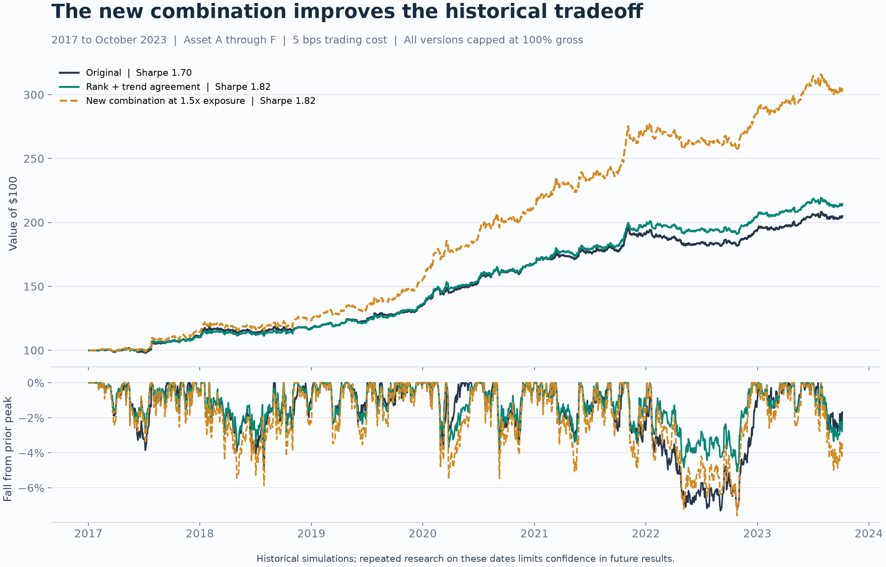
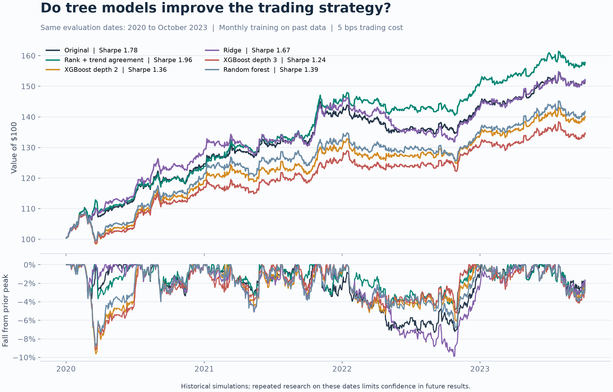
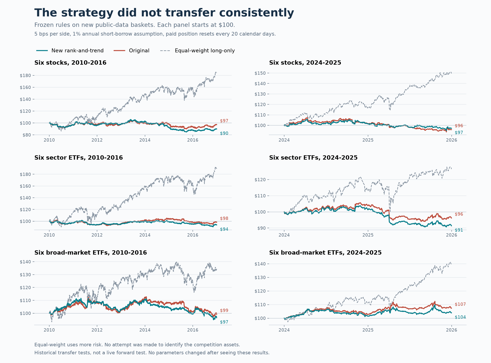

# BSE Quant Strategy

A fixed-rule, multi-day trading strategy for the BSE Quant Track competition. It combines relative-strength long/short positions with a long-only trend component. It trades Assets A through F. **Asset G is excluded.**

This repository contains the final submission code, a local backtester, tests, and charts from the research. The final version uses the simpler original rules, not the later rank-and-trend variant or machine-learning models.

**Research status:** positive results on reused competition data, weak transfer results on other assets, and no untouched validation set. This is a competition submission, not evidence of a reliable live-trading edge.

[Download the final submission ZIP](submission/BSE_Final_Submission.zip) · [Strategy details](STRATEGY.md) · [Evaluator interface](docs/RUNNING.md#evaluator-interface)

## How it works

1. Estimate recent volatility and each asset's beta to the six-asset basket.
2. Use half the allocation for 20-session relative and overnight momentum, with estimated beta and net exposure removed from that component.
3. Use the other half to buy up to two assets with positive 120-session momentum.
4. Scale each component down when forecast annual volatility exceeds 8%, average five daily signals, and cap total target gross exposure at 100%.
5. Schedule a full cash session after 14 calendar days of decision history in an exposure cycle. Completed-day signals execute at the following open.

The full portfolio is **not market neutral**, because half the allocation is long-only. There are no fitted per-asset constants, trained models, or leverage boosts. The holding control depends on the evaluator honoring zero targets and next-open execution.

## Run it

Use Python 3.10 or newer. NumPy is the only runtime dependency.

```sh
python3 -m venv .venv
source .venv/bin/activate
python -m pip install -r requirements.txt
python -m unittest -v test_strategy.py
python run_on_csv.py --data-dir /path/to/Fellows_Data --output allocations.csv
```

On Windows, activate the environment with `.venv\Scripts\activate`.

### Input

Supply `Asset_A.csv` through `Asset_F.csv` in one folder, with matching dates. Each file needs `Date` in `YYYY-MM-DD` format, `Open`, and `Close` or `Close/Last`. Currency symbols and commas in prices are accepted. Competition data are not included in this repository.

### Output

`allocations.csv` contains `Decision_Date` and seven target weights. A weight of `0.10` means 10% of portfolio equity; negative values are short positions. Asset G is always zero. Each row applies at the **next session's open**, not the decision day's open.

An all-zero row means close every position and stay in cash for that session. Keep strategy state across calls and replay warm-up history before hidden scoring. See the [full interface instructions](docs/RUNNING.md).

### Backtest

```sh
python backtest.py --data-dir /path/to/Fellows_Data --start 2017-01-01 --end 2023-10-06 --fee-bps 5 --output-dir results
```

This writes `daily.csv`, `annual.csv`, and `summary.json`. For stress tests, use `--fee-bps 20` or add `--annual-borrow-rate 0.01`. The simulator tracks cash and marked holdings, charges costs on actual changed notional, and charges terminal liquidation. It is not the official competition evaluator.

## Final submission results

These figures belong to the code in this repository, including its scheduled cash sessions. The scoring period is January 3, 2017 through October 6, 2023: 1,702 sessions, including initial warm-up cash. Returns use 252-session annualization; Sharpe is measured against zero cash yield.

| One-way cost | Annual short borrow | Total return | Annualized return | Sharpe | Max drawdown |
|---|---|---:|---:|---:|---:|
| 5 bps | 0% | +73.41% | 8.49% | 1.36 | 7.41% |
| 5 bps | 1% | +72.11% | 8.37% | 1.34 | 7.48% |
| 20 bps | 0% | +30.40% | 4.01% | 0.67 | 10.90% |

Full values: [development results](development_results.csv) and [annual results](annual_results.csv). These are development results, not out-of-sample estimates. Earlier research used the same history to compare many alternatives.

## Research charts

**The charts below show earlier experiments, not the exact final submission.** Their strategy versions, scoring windows, and holding conventions differ. Do not use their higher Sharpe ratios as claims about the submitted code.

### Rule changes and increased exposure

Comparison of the original hybrid, a later rank-and-trend variant, and increased exposure on the supplied history. The final submission drops the later changes and adds scheduled cash sessions, so its results are the table above, not the roughly 1.82 Sharpe shown for the challenger here.



### Linear models, random forest, and XGBoost

Earlier model comparisons over the same 2020 to October 2023 scoring window. These were research comparisons on reused history, not a pristine holdout. The final submission does not use any of these fitted models.



### Transfer to other assets

Frozen earlier rules were tested on stock, sector ETF, and broad-market ETF baskets in 2010–2016 and 2024–2025. The later rank-and-trend variant lost money in five of six basket-period tests at 5 bps per side and a 1% annual short-borrow assumption. The original rules were also weak. These tests used paid same-open position resets every 20 calendar days, not the final version's 14-day full-cash-session control.



The baskets use selected surviving assets, so they are a limited robustness check. They do not validate the final holding-control version. No attempt was made to identify the anonymous competition assets.

## Files

| File | Purpose |
|---|---|
| `strategy.py` | Stateful daily strategy and evaluator entry point |
| `run_on_csv.py` | Read A–F CSVs and write next-open target weights |
| `backtest.py` | Local next-open simulator with trading and borrow costs |
| `test_strategy.py` | Ten tests for timing, invariants, input checks, and accounting |
| `STRATEGY.md` | Method, holding control, results, and limitations |
| `docs/RUNNING.md` | Detailed setup and evaluator contract |
| `docs/images/` | The three research charts displayed above |
| `submission/BSE_Final_Submission.zip` | Unchanged final submission archive |

The submission archive has SHA-256 `4f693fd38075906d1951c1916b714b01507de24e214b35889d8ef419555b9600`.

## Limits

The final version removes later tuning, but cannot undo earlier strategy selection. No untouched competition-data holdout remains. The simulator does not separately model dividends, financing, cash interest, taxes, or market impact beyond the specified costs. Borrow availability is not guaranteed. Target exposure limits do not constrain price drift between rebalances, and exceptional closures or suspensions require evaluator handling.

Historical gains do not establish future profitability. Raw competition data, external price downloads, credentials, and local research environments are deliberately excluded.
